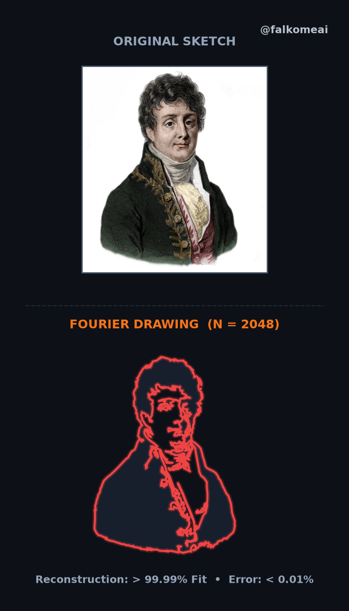
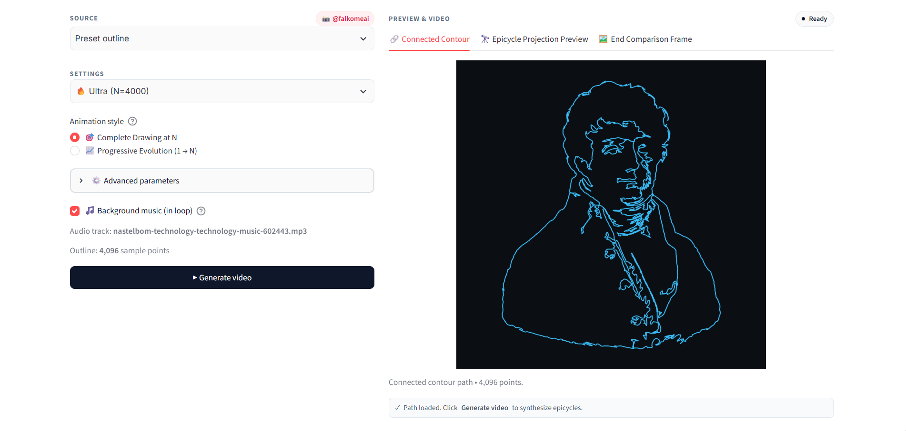
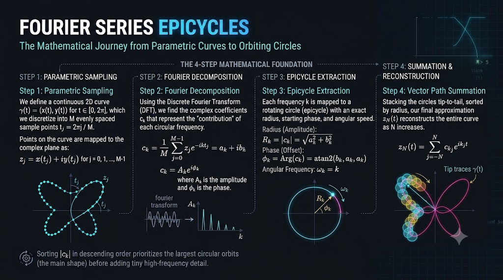

# 🌀 falkourier — Fourier Epicycle Drawing Studio

[](https://pypi.org/project/falkourier/)
[](https://www.python.org/downloads/)
[](https://fourier-studio.streamlit.app/)
[](https://falkomeAI.github.io/Fourier-Epicycle-Drawing-Studio/)
[](LICENSE)
[](https://instagram.com/falkomeai)
[](https://github.com/falkomeAI/Fourier-Epicycle-Drawing-Studio)


> 🚀 **Live Online Deployments**:
> - **Full Python Web Studio**: **[https://fourier-studio.streamlit.app](https://fourier-studio.streamlit.app/)** *(Complete 4096-harmonic engine, automated video outro & audio loop)*
> - **Interactive Canvas Demo**: **[https://falkomeAI.github.io/Fourier-Epicycle-Drawing-Studio](https://falkomeAI.github.io/Fourier-Epicycle-Drawing-Studio/)** *(Client-side in-browser real-time DFT)*

**falkourier** is a high-precision **Fourier Series Epicycle Drawing Engine** and **Animation Studio**. Transform photos, sketches, and mathematical curves into continuous closed loops drawn dynamically by rotating epicycle chains with exact real-time projection formulas, harmonic progress counters, and seamless background audio.

---

## 📑 Table of Contents

- [Overview](#overview)
- [Visual Showcase & Screenshots](#visual-showcase--screenshots)
- [Mathematical Foundation](#mathematical-foundation)
- [Key Features](#key-features)
- [Pip Package & Installation](#pip-package--installation)
- [Python API Usage](#python-api-usage)
- [CLI Tools](#cli-tools)
- [Web Studio UI](#web-studio-ui)
- [Contour Extraction Pipelines](#contour-extraction-pipelines)
- [Creator & Attribution](#creator--attribution)
- [License](#license)

---

<a id="overview"></a>
## 🌟 Overview

The **Fourier Epicycle Drawing Studio** decomposes any 2D closed curve into harmonic components. It reconstructs complex portraits, line art, and geometric shapes using two synchronized epicycle chains:
- **Horizontal X-Chain (Top, Cyan)**: Evaluates the Fourier series for the $x$-coordinate over time $t$.
- **Vertical Y-Chain (Left, Amber)**: Evaluates the Fourier series for the $y$-coordinate over time $t$.
- **Pen Intersection**: Guide lines extend from the tips of both chains to meet at the drawing pen $[x_N(t), y_N(t)]$, tracing the outline with absolute mathematical fidelity.

```
                  ┌──────────────────────┐
                  │ X-Epicycle Chain (t) │  ──┐
                  └──────────────────────┘    │
                             │                ▼
                             ▼          [ Vertical Guide ]
                   [ Horizontal Guide ]       │
                             │                ▼
┌──────────────────────┐     │          ┌───────────┐
│ Y-Epicycle Chain (t) │ ────┴────────► │  Pen Tip  │ ──► [ Complete Drawing ]
└──────────────────────┘                └───────────┘
```

---

<a id="visual-showcase--screenshots"></a>
## 📸 Visual Showcase & Screenshots

### 1. Dual X/Y Epicycle Projection Preview ($N = 4000$)
Live static simulation showing independent X and Y epicycle chains, dashed guide lines, glowing pen tip, exact reconstruction error, and fit metrics.


---

### 2. Video Outro Comparison Frame
Automatic 2.5-second outro frame synthesized at the end of each generated video:
- **Up side**: Original sketch / input portrait.
- **Down side**: Synthesized Fourier drawing ($N = 4000$) with accuracy metrics ($> 99.99\%$ Fit, $< 0.01\%$ Error) and `@falkomeai` branding.



---

### 3. Continuous Single-Loop Tour Chaining
All extracted contours and disconnected boundary pieces are chained into a single continuous, non-intersecting loop using spatial KDTree detours.



---

<a id="mathematical-foundation"></a>
## 📐 Mathematical Foundation



A continuous closed parametric curve $\gamma(t) = (x(t), y(t))$ for $t \in [0, 2\pi]$ is decomposed into trigonometric Fourier series:

### 1. Dual Real Series Representation

$$x_N(t) = \frac{a_0}{2} + \sum_{k=1}^N \left( a_k \cos(kt) + b_k \sin(kt) \right)$$

$$y_N(t) = \frac{c_0}{2} + \sum_{k=1}^N \left( c_k \cos(kt) + d_k \sin(kt) \right)$$

Where the Fourier coefficients are computed over $M$ sample points $t_j = \frac{2\pi j}{M}$:

$$a_k = \frac{2}{M} \sum_{j=0}^{M-1} x(t_j) \cos(k t_j), \quad b_k = \frac{2}{M} \sum_{j=0}^{M-1} x(t_j) \sin(k t_j)$$

$$c_k = \frac{2}{M} \sum_{j=0}^{M-1} y(t_j) \cos(k t_j), \quad d_k = \frac{2}{M} \sum_{j=0}^{M-1} y(t_j) \sin(k t_j)$$

Each harmonic $k$ corresponds to a rotating circle (epicycle) of radius $R_k = \sqrt{a_k^2 + b_k^2}$ with angular frequency $k$.

### 2. Complex Fourier Series Representation

$$z_N(t) = \sum_{j=1}^N c_{k_j} e^{i k_j t}, \quad c_k = \frac{1}{M} \sum_{j=0}^{M-1} z(t_j) e^{-i k t_j}$$

Frequencies are sorted in descending order of magnitude $|c_k|$, prioritizing dominant geometric features before fine details.

---

<a id="key-features"></a>
## ✨ Key Features

- **Ultra-High Harmonic Detail ($N = 4000+$)**:
  Supports high harmonic ceilings with adaptive Nyquist-rate path sampling, delivering over **99.99% reconstruction fit** and **< 0.01% error**.
- **Dual Representation Modes**:
  - **Dual-Chain X/Y Projection**: Independent real-valued series $x_N(t)$ and $y_N(t)$ with perpendicular guides and live formulas.
  - **Single Complex Chain**: Complex exponential series $z_N(t) = \sum c_k e^{i k t}$ in the complex plane.
- **Continuous Closed-Loop Contour Engine**:
  Chains multiple contours and disconnected line segments into a single, seamless, non-intersecting tour using spatial tree detours.
- **Full-Resolution Processing**:
  Always extracts edges and computes Fourier harmonics from the original, unresized source image, while using optimized display copies for UI previews.
- **Interactive Web Studio UI**:
  A modern dark-mode Streamlit dashboard with real-time vector tabs:
  - 🔗 **Connected Contour**: Displays the raw closed tour and point density.
  - 🔭 **Epicycle Projection Preview**: Live static projection preview with harmonics, error, and fit metrics.
  - 🖼️ **End Comparison Frame**: Outro card featuring the original sketch on top and the synthesized Fourier drawing on the bottom.
  - 📷 **Original Photo Overlay**: Visual validation of traced contours directly over the uploaded image.
- **Automated Video Outro & Audio Loop**:
  Generates MP4 animations with seamless audio looping from the `audio/` directory, gradual fade-out, and a 2.5-second side-by-side comparison outro.
- **Clean & Professional Branding**:
  Clean interface without third-party references, watermarked exclusively with **`@falkomeai`**.

---

<a id="project-architecture"></a>
## 🏗️ Project Architecture

```
Fourier-Epicycle-Drawing-Studio/
├── apps/
│   ├── web_app.py              # Streamlit interactive Web Studio UI
│   ├── cli_instagram_xy.py     # Dual-chain X/Y Instagram video generator
│   ├── cli_instagram.py        # Single complex-chain Instagram generator
│   ├── cli_xy.py               # Dual-chain desktop & side-by-side video generator
│   ├── cli_complex.py          # Single complex-chain desktop video generator
│   └── cli_epicycle_studio.py  # Dual-chain vertical portrait animator
├── src/
│   ├── falkourier/             # Core falkourier pip package module
│   │   ├── __init__.py         # Public API exports & package metadata
│   │   ├── cli.py              # CLI entry point (falkourier & falkourier-studio)
│   │   ├── series.py           # Real two-axis Fourier series computation
│   │   ├── complex_series.py   # Complex exponential Fourier series & harmonic ranking
│   │   ├── image_path.py       # High-detail boundary extraction & continuous tour chaining
│   │   ├── schedule.py         # Progressive N scheduling & Nyquist sample point scaling
│   │   ├── shapes.py           # Built-in mathematical curves (hummingbird, heart, star, etc.)
│   │   ├── ai_path.py          # Neural line art extraction & closed tour solver
│   │   └── offline_render.py   # Headless video rendering engine via ffmpeg
│   └── fourier_drawing/        # Backwards-compatibility wrapper
├── pyproject.toml              # Modern PEP 621 package specification
├── setup.py                    # Build & distribution configuration
├── assets/
│   ├── math_formula_banner.png          # High-resolution mathematical formula banner
│   ├── preview_epicycle_studio.png      # High-resolution epicycle drawing screenshot
│   ├── preview_comparison_endcard.png   # Outro comparison frame screenshot
│   ├── preview_connected_contour.png    # Continuous closed contour screenshot
│   ├── fourier-points.json              # Built-in portrait preset outline
│   └── sample_portrait.jpg              # High-resolution sample portrait for testing
├── audio/
│   └── *.mp3                   # Background music tracks for automatic video looping
├── output/                     # Generated MP4 videos and preview renders
├── requirements.txt            # Python dependencies
├── LICENSE                     # MIT License
└── README.md                   # Documentation
```

---

<a id="pip-package--installation"></a>
## 📦 Pip Package & Installation

### Option A: Install via PyPI (Recommended)
```bash
pip install falkourier
```

### Option B: Install from GitHub Source
```bash
git clone https://github.com/falkomeAI/Fourier-Epicycle-Drawing-Studio.git
cd Fourier-Epicycle-Drawing-Studio
pip install -e .
```

> **Note**: `ffmpeg` is automatically bundled via `imageio-ffmpeg`. If using a barebones Linux container, install ffmpeg with `sudo apt install ffmpeg`.

---

<a id="python-api-usage"></a>
## 🐍 Python API Usage

You can use **falkourier** directly inside your Python scripts or Jupyter notebooks:

```python
import falkourier as fk

# 1. Access built-in mathematical curves
path = fk.SHAPES["hummingbird"]()

# 2. Or extract continuous closed contour from any image
path = fk.extract_boundary_contour_path("assets/sample_portrait.jpg", target_points=4096)

# 3. Fit real dual-axis Fourier series
fit_result = fk.fit_fourier(path[:, 0], path[:, 1], n_harmonics=500)
print(f"X Harmonics: {len(fit_result['x_coeffs']['an'])}, Y Harmonics: {len(fit_result['y_coeffs']['cn'])}")

# 4. Fit single-chain complex Fourier series
complex_result = fk.fit_complex_fourier(path[:, 0], path[:, 1], n_harmonics=500)
print(f"Computed {len(complex_result['harmonics'])} complex rotating epicycles.")
```

---

<a id="cli-tools"></a>
## ⚡ CLI Tools

Once installed via pip, **falkourier** gives you immediate terminal commands:

### 1. Generate Fourier Epicycle Videos (`falkourier`)
```bash
# Render from an image with 500 harmonics
falkourier --image assets/sample_portrait.jpg --n 500 --save output/portrait.mp4

# Render a built-in shape (hummingbird, heart, star, butterfly, etc.)
falkourier --shape hummingbird --n 300 --save output/hummingbird.mp4

# Render vertical 9:16 Instagram Reels / TikTok format (1080x1920)
falkourier --shape heart --n 250 --format reels --save output/heart_reel.mp4
```

### 2. Launch Interactive Studio UI (`falkourier-studio`)
```bash
falkourier-studio
```
*Launches the Streamlit Studio UI directly in your browser with zero configuration!*

---

<a id="web-studio-ui"></a>
## 🎮 Web Studio UI

If developing from the repository clone, you can also launch the Web Studio with:
```bash
streamlit run apps/web_app.py
```
Open your browser to `http://localhost:8501`.

#### Web Studio Features:
1. **Source Selection**: Choose `Preset outline`, `Upload image` (PNG, JPG, WEBP), or `Built-in shape`.
2. **Contour Extraction**: Choose from high-detail boundary tracing, adaptive thresholding, edge detection, or AI segmentation.
3. **Harmonic Presets**:
   - ⚡ **Quick** ($N = 100$ harmonics) — Instant preview & fast render
   - ✨ **Detailed** ($N = 500$ harmonics) — High fidelity
   - 🎯 **High Detail** ($N = 1024$ harmonics) — Sharp details
   - 🔥 **Ultra** ($N = 4000$ harmonics) — Maximum precision ($> 99.99\%$ fit)
4. **Export**: Full 60fps MP4 animation with synchronized audio, rotating epicycle projections, and endcard comparison.

---

<a id="contour-extraction-pipelines"></a>
## 🔍 Contour Extraction Pipelines

| Method | Description | Best For |
| :--- | :--- | :--- |
| **⚫ High-Detail Boundary Contours** | Full-resolution boundary tracing with nearest-contour tour chaining | High-contrast portraits, intricate line art, detailed sketches |
| **✏️ Adaptive Threshold** | Local Gaussian window adaptive binarization | Pencil sketches, handwritten drawings, varying illumination |
| **🔍 Edge Detection** | Multi-stage gradient edge filtering | Photos with subtle contrast and fine geometric lines |
| **🌓 Binary Threshold** | Global Otsu variance-maximizing binarization | High-contrast black & white graphics, silhouettes |
| **📸 Foreground Subject Isolation** | Iterative graph-cut energy minimization | Isolating foreground objects from complex backgrounds |
| **🔲 PNG Alpha Channel** | Direct extraction from 4-channel transparent PNG | Logos, digital graphic designs, transparent cutouts |
| **🤖 AI Object Segmentation** | Neural instance mask segmentation | Complex real-world photographs with multiple background items |

---

<a id="configuration--cli-options"></a>
## ⚙️ Configuration & CLI Options

Key options available across CLI generators (`apps/cli_instagram_xy.py`, `apps/cli_xy.py`, `apps/cli_complex.py`):

| Parameter | Type | Default | Description |
| :--- | :--- | :--- | :--- |
| `--image` | `str` | `""` | Path to input image (`.png`, `.jpg`, `.jpeg`, `.webp`) |
| `--shape` | `str` | `"hummingbird"` | Built-in curve (`hummingbird`, `heart`, `star`, etc.) |
| `--n` | `int` | `100` | Number of Fourier harmonic pairs ($1$ to $4096$) |
| `--points` | `int` | `0` | Sample point count ($0$ = auto-calculated for optimal Nyquist resolution) |
| `--fps` | `int` | `30` | Output video frames per second |
| `--frames-per-n` | `int` | `50` | Frames rendered per harmonic milestone |
| `--hold` | `int` | `3` | Duration (seconds) to display final completed outline |
| `--format` | `str` | `"square"` | Aspect ratio: `"square"` ($1080\times 1080$) or `"reels"` ($1080\times 1920$) |
| `--method` | `str` | `"auto"` | Extraction algorithm: `boundary`, `adaptive`, `canny`, `otsu`, `grabcut`, `alpha`, `lineart`, `ai` |
| `--save` | `str` | `"output/...mp4"` | Destination path for output video file |
| `--no-formula` | `flag` | `False` | Omit mathematical formula overlays from canvas |
| `--no-silhouette`| `flag` | `False` | Omit background silhouette fill |

---

<a id="audio--outro-integration"></a>
## 🎵 Audio & Outro Integration

- **Seamless Audio Looping**: Place any `.mp3` or `.wav` soundtrack in the `audio/` directory. The video rendering pipeline automatically loops the track to match the duration of the animation and applies a smooth **1.2-second linear audio fade-out** at the end.
- **End Comparison Frame**: Every generated video includes an automated **2.5-second comparison outro**:
  - **Up side**: Original sketch / input photo.
  - **Down side**: Synthesized Fourier drawing with harmonic count ($N = \text{number}$).
  - **Accuracy Metrics**: Reconstruction Fit percentage ($> 99.99\%$) and error deviation ($< 0.01\%$).
  - **Branding**: Clean `@falkomeai` creator attribution watermark.

---

<a id="creator--attribution"></a>
## 👤 Creator & Attribution

Created & Designed by **[@falkomeai](https://instagram.com/falkomeai)**.

---

<a id="license"></a>
## 📄 License

This project is open-source under the [MIT License](LICENSE).
